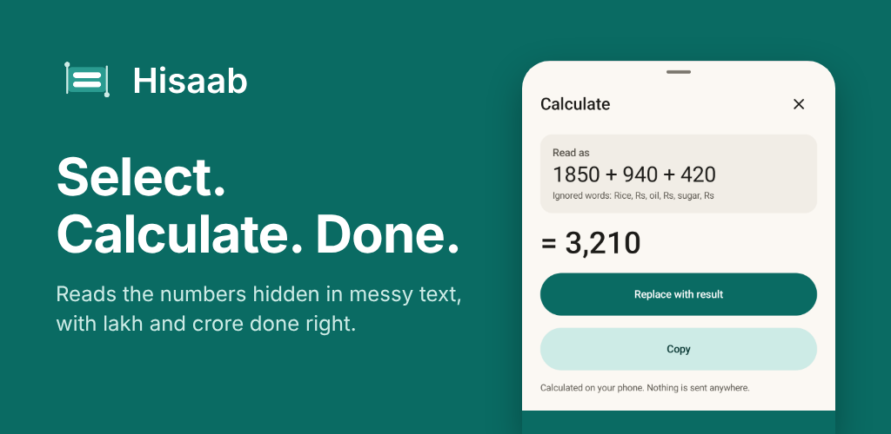
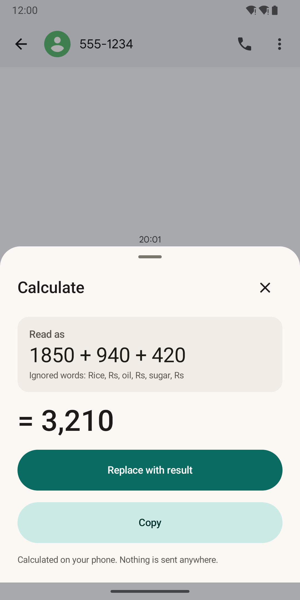
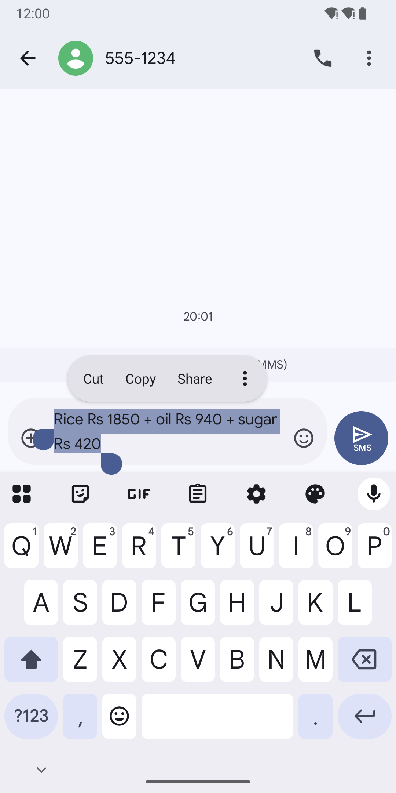
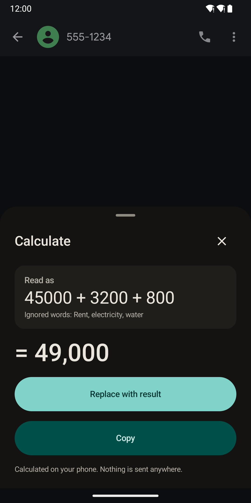
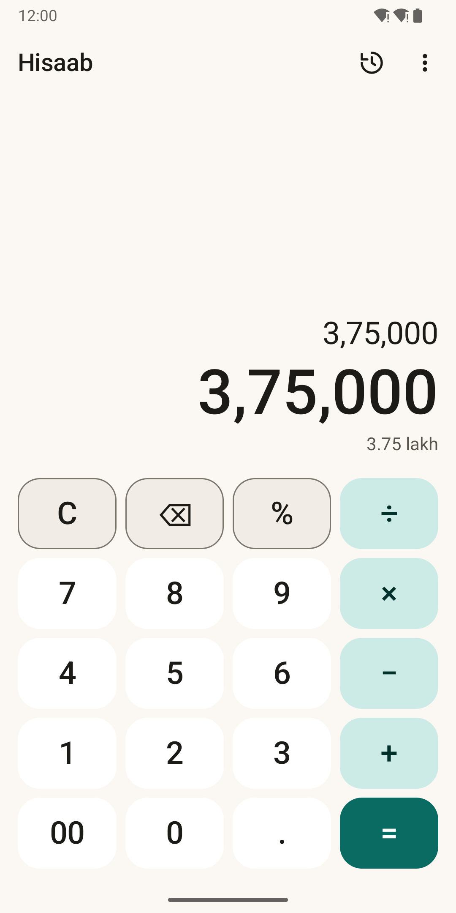
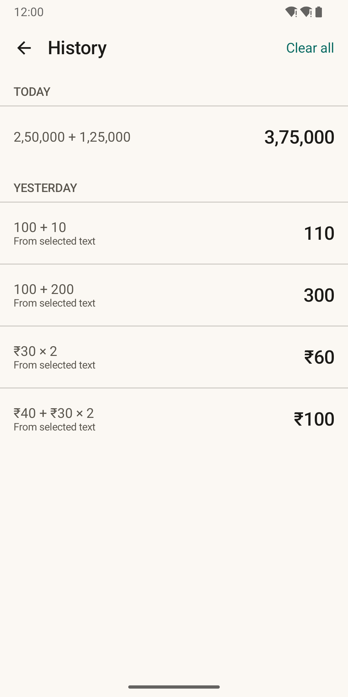

<p align="center">
  
</p>

# Hisaab - Calculator

> Select numbers in any app, tap Calculate. Lakh and crore ready. No internet.


## About
Hisaab is a calculator that works where your numbers already are.

Got a message like "Lunch ₹320 + tip ₹40"? Select the text, tap the three dots (on some phones "More"), then tap **Calculate**. Hisaab reads the numbers, ignores the words, and shows the answer in a small box at the bottom. Tap Replace to put the result back, or Copy to use it anywhere.

Everything is calculated on your phone. Hisaab has no internet access, no ads, and no account. Your text and your history never leave your device.

## Features
- **Calculate from selected text** in chats, browsers, notes and more
- **Shows you how it read your text**, so you can check or fix it
- **A simple calculator** with big, easy keys for everyday sums
- **Indian number format** (12,34,567.89) with lakh and crore in words
- **Understands** +, −, ×, ÷ and percentages
- **History of your answers**, grouped by day. Clear it any time
- **Light and dark themes**

## Screenshots

| Calculate Sheet | Select Text | Dark Theme | Main Calculator | History |
|:---:|:---:|:---:|:---:|:---:|
|  |  |  |  |  |

## Tech Stack
- **Language**: Kotlin
- **UI Toolkit**: Jetpack Compose
- **Architecture**: Modular (`app`, `core:designsystem`, `core:parser`)
- **Minimum SDK**: 24
- **Target SDK**: 37

## Getting Started

### Prerequisites
- [Android Studio](https://developer.android.com/studio)
- JDK 11 or higher

### Clone the Repository
```bash
git clone https://github.com/vickypoojari/hisaab-calculator.git
cd hisaab-calculator
```

### Build & Run
To run the debug version on an emulator or connected device:
```bash
./gradlew installDebug
```
To build the release App Bundle (AAB):
```bash
./gradlew bundleRelease
```

## Project Structure
```text
hisaab-calculator/
├── app/               # Main Android application module
├── core/
│   ├── designsystem/  # Shared Compose UI components and theme
│   └── parser/        # Text parsing logic for calculation
├── build-logic/       # Convention plugins for build configuration
├── docs/              # Play Store listing assets, policies, and screenshots
└── gradle/            # Gradle wrapper and version catalogs
```

## Usage
1. **Touch and hold** a word and drag to select the numbers in any app (like WhatsApp, Chrome, Notes).
2. **Tap the three dots** ("More") in the context menu that appears.
3. **Tap Calculate**. If you don't see it, scroll the menu.
4. If the sum looks wrong, tap **Edit**, fix it, and the answer updates immediately.

## Contributing
Contributions are welcome! Please feel free to submit a Pull Request.

## Author
**Vicky Poojari** - [@vickypoojari](https://github.com/vickypoojari)
